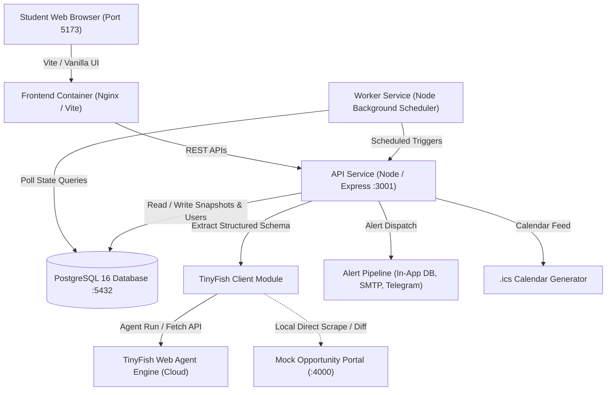
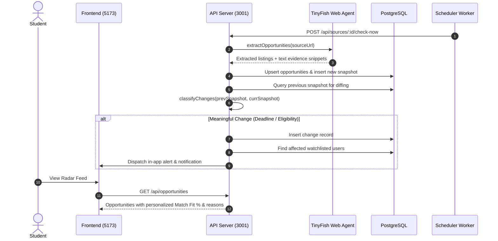

# OpportunityRadar – Architecture & Technical Specification

OpportunityRadar is an autonomous intelligence platform that tracks student opportunities (internships, hackathons, and scholarships), extracts structured ground truth via **TinyFish Web Agents**, classifies critical silent changes (deadlines, eligibility, stealth closures), and calculates personalized qualification fit scores.

The system is fully containerized across 5 coordinated services managed with **Docker Compose**.

---

## 1. System Architecture

---

## 2. Mandatory Sponsor Technologies

### A. TinyFish Web Agent Engine
TinyFish provides autonomous web navigation and schema-driven data extraction:
- **Authentication**: Secured using the `X-API-Key` header with `TINYFISH_API_KEY` from environment variables.
- **Agent API (`POST https://agent.tinyfish.ai/v1/automation/run`)**: Navigates target pages, executes structured goals, extracts opportunity cards, and captures exact sentence-level **evidence snippets** supporting every extracted field.
- **Search & Fetch APIs**: Fast multi-URL fetching and web search for opportunity discovery.
- **Adapter Module (`api/src/tinyfish_client.js`)**: A thin, decoupled client layer isolating the rest of the application from HTTP implementation details.

### B. Docker & Multi-Container Orchestration
The entire application runs through multi-stage Docker builds orchestrated via `docker-compose.yml`:
1. **`db`** (`postgres:16-alpine`): Stores users, profiles, sources, opportunities, historical snapshots, changes, and alerts with automated schema (`init.sql`) and seed data (`seed.sql`).
2. **`mock-portal`** (`Node 20 alpine`): Simulates live university and hackathon announcement pages with mutable admin endpoints to demonstrate instant change detection during live demos.
3. **`api`** (`Node 20 alpine`): Express server handling authentication, matching engine, snapshot processing, diff classification, and calendar feeds.
4. **`worker`** (`Node 20 alpine`): Autonomous background daemon monitoring source polling intervals and orchestrating snapshot cycles.
5. **`frontend`** (`Nginx 1.25 alpine`): High-performance static web server hosting the glassmorphic Vite SPA with gzip compression and clean SPA fallback routing.

---

## 3. Data Processing & Snapshot Lifecycle

---

## 4. Change Classification Engine (`change_engine.js`)

When two snapshots of an opportunity are compared, the engine classifies differences:
- `DEADLINE_CHANGED`: Identifies extensions (more time!) vs early closures.
- `ELIGIBILITY_CHANGED`: Analyzes modified academic year criteria, branch restrictions, or prerequisites.
- `REWARD_CHANGED`: Stipend or prize pool modifications.
- `LISTING_CLOSED`: Opportunity removed or marked closed before deadline.
- `COSMETIC`: Minor typo or layout changes (suppressed from user notification noise).

---

## 5. Personalization & Matching Engine (`matcher.js`)

The match engine compares an opportunity's strict eligibility wording against a student's profile:
1. **Academic Year Fit**: Evaluates whether the student's year (e.g. "3rd year") satisfies requirements like "Pre-final only" or "Penultimate year".
2. **Discipline / Branch Fit**: Compares major (e.g. CS/IT, Electrical) against target departments.
3. **Skills & Interests**: Measures overlap between student skills (e.g. Python, ML, React) and project requirements.
4. **Plain-Language Explanations**: Generates clear rationale so students know *why* they qualify or what prerequisite they are missing.
